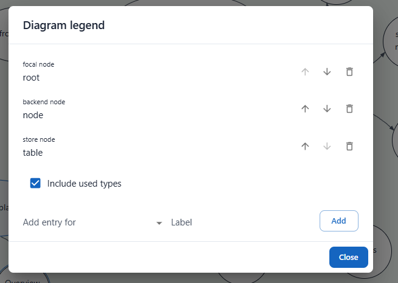

Check this image when shown for adding a legend item. it still has all the existing items and for adding a new item, it has a checkbox to include existing types. this is all totally wrong. This is an 'edit dialog' and an add dialog put together