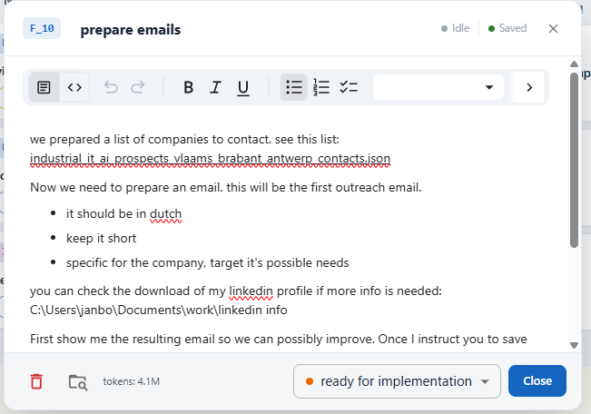

see the current json editor (for lists):

and for the objects:

compared to the design of the cards:

which is much better.

so we need to improve the design. some things I can already come up with:

* title
* the border of the popup, I think the card has a shadow, lets use the same for the json editor
* lets drop the card but use the footer bar and show the list actions there
* use icons for the list actions (like `add` and such)