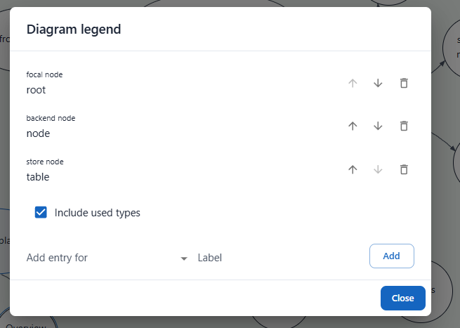

Check this image when shown for adding a legend item. it still has all the existing items and for adding a new item, it has a checkbox to include existing types. this is all totally wrong. This is an 'edit dialog' and an add dialog put together. All we need is the add.

## Current state

- Two triggers open the same dialog through `diagramObjectDetailsService.open({ objectKind: 'legend' })`:
  - the `+` button ("Add legend entry") in the legend panel header (`legend/diagram_legend.tsx`), shown while an edit session is active;
  - the ribbon `DiagramLegendButton` (`legend/diagram_legend_button.tsx`, label "Legend", tooltip "Edit diagram legend").
- `details/diagram_object_details_dialog.tsx` renders the title "Diagram legend" and `legend/diagram_legend_details_editor.tsx` as body.
- `DiagramLegendDetailsEditor` mixes two jobs:
  - **edit**: lists every explicit legend entry through `DiagramLegendEntryEditor` (label field, move up, move down, remove);
  - **add**: "Include used types" checkbox, "Add entry for" picker, "Label" field, "Add" button, and one "Close" action.
- Picker content: types are hidden when they already have a legend entry. Types used by nodes or edges of the diagram are hidden unless "Include used types" is checked; `useUsedLegendEntryKeys` exists only to compute that split.
- Legend panel rows (`legend/diagram_legend_entry_row.tsx`) already rename and remove entries inline while a session is passed (New tab, creation session). Both first call `session.legend.materializeDerivedLegend()` so a derived legend (no `meta.legend` stored) becomes explicit before the edit.
- Reorder exists only in the dialog (`DiagramLegendEntryEditor` up/down → `session.legend.moveLegendEntry(entryKey, targetIndex)`). `moveLegendEntry` throws when the legend is still derived, because the entry is not found in `meta.legend`.
- Legend entry identity is its semantic (`diagramLegendEntryKey` → `node:<role>`, `nodeKind:<kind>`, `connection:<kind>`); the file format has no entry id. `addLegendEntry` rejects a second entry with the same semantic.
- `@dnd-kit/core` and `@dnd-kit/sortable` are already dependencies (used by `config/columns_editor.tsx`, `card_view/card_column.tsx`).

## Implementation details

Paths relative to `app/src/components/diagram_view/`.

### Add-only dialog

- `legend/diagram_legend_details_editor.tsx`:
  - remove the entry list, `DiagramLegendEntryEditor` usage, the "Include used types" checkbox and its state/handler, `useUsedLegendEntryKeys`, the used/unused split, and the "Unused types" / "Used types" subheaders;
  - picker lists every option of `semanticOptions` (all roles, valid node kinds, connection kinds of the diagram type), including types already in the legend;
  - keep the derived-legend note ("Adding an entry keeps those derived entries"), the label prefill, and the existing validation messages;
  - `DialogActions` bottom right: "Cancel" (calls `onClose`, no change) and "Add" (contained, primary);
  - "Add": no type chosen → existing "Choose the node kind…" message, dialog stays open. `addLegendEntry` returns `null` (duplicate semantic or invalid) → existing "already has a legend entry" message, dialog stays open. Success → `onClose()`.
  - update the JSDoc: component adds one legend entry.
- Delete `legend/diagram_legend_entry_editor.tsx` (only call site is the dialog).
- `details/diagram_object_details_dialog.tsx`: `SINGLETON_TITLES.legend` → "Add legend entry".
- `legend/diagram_legend_button.tsx`: tooltip → "Add legend entry"; JSDoc → opens the add-legend-entry dialog. Label "Legend" unchanged.

### Drag reorder in legend panel

- Edit mode = `session` prop present on `DiagramLegendEntryList` (New tab or creation session). Current tab and read-only view: no handles, no reorder.
- `legend/diagram_legend_entry_list.tsx`: when `session` is present, wrap rows in `DndContext` (`PointerSensor` + `KeyboardSensor` with `sortableKeyboardCoordinates`) and `SortableContext` (`verticalListSortingStrategy`, items = entry keys). On drag end with a different target: `session.legend.materializeDerivedLegend()`, then `session.legend.moveLegendEntry(activeKey, targetIndex)` where `targetIndex` = index of `over` key in current entries.
- `legend/diagram_legend_entry_row.tsx`: when `session` is present, call `useSortable({ id: entryKey })`, apply transform/transition to the row `Box`, and render a drag handle `IconButton` (`DragIndicatorOutlined`, `aria-label="Reorder <label>"`, tooltip "Drag to reorder") in front of the sample. Listeners only on the handle so label editing, select, remove, and format stay usable.
- Legend panel move: `diagram_legend.tsx` pointer handlers are on the header box only, so row handles do not start a panel move.
- Panel refresh after reorder: `moveLegendEntry` dispatches legend membership changed → `useSessionLegendEntries` rebuilds entries. No new event.

### Out of scope

- Multiple legend entries of the same type: needs an entry id in the legend file format and rekeying legend edit plumbing (editor, read adapter, change registry, events, change descriptions). Separate card. Until then duplicates stay rejected with the existing message.
- Revisiting the type list offered by the picker.

### Edge cases

- Derived legend + add: `addLegendEntry` already keeps derived entries (B_252).
- Derived legend + drag: materialize before move, otherwise `moveLegendEntry` throws.
- Drag dropped on own position or outside list: no call.
- Picker option already in legend: selectable; Add shows duplicate message.

### Tests

- `legend/diagram_legend_details_editor.test.tsx`: remove list/rename/reorder/remove/checkbox tests. Add: no entry list and no checkbox rendered; picker lists used, unused, and already-in-legend types; Add commits entry and calls `onClose`; Cancel calls `onClose` without legend change; duplicate type shows message and does not call `onClose`; no type chosen shows message. Update the `DiagramLegendButton` test name if it mentions editing.
- `legend/diagram_session_legend_entries.test.tsx`: handle per row in edit mode; keyboard drag (space, arrow down, space) reorders explicit legend; same on derived legend materializes then reorders.
- `legend/diagram_legend.test.tsx`: Current tab renders no reorder handles.

## Acceptance criteria

- [ ] Legend panel `+` and ribbon "Legend" button open a dialog titled "Add legend entry".
- [ ] Dialog shows no existing entries and no "Include used types" checkbox.
- [ ] Picker lists all node roles, valid node kinds, and connection kinds of the diagram type, used or not.
- [ ] Choosing a type prefills the label; label editable.
- [ ] "Add" adds the entry and closes the dialog; new entry appears in the legend panel New tab.
- [ ] "Add" with a type already in the legend shows the duplicate message; dialog stays open; legend unchanged.
- [ ] "Add" without a type shows the choose message; dialog stays open.
- [ ] "Cancel" closes the dialog without changes; Cancel and Add sit bottom right.
- [ ] Adding to a derived legend keeps the derived entries.
- [ ] In edit mode each legend panel row shows a drag handle in front of the item; dragging reorders the legend, also when the legend was derived.
- [ ] Current tab and read-only legend show no drag handles.
- [ ] Inline rename, remove, select, and format in legend rows keep working.
- [ ] `DiagramLegendEntryEditor` removed; lint and touched tests pass.